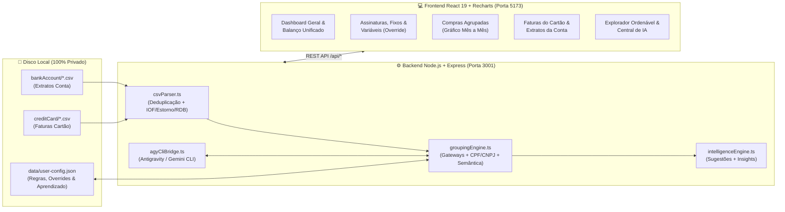

# 💜 Nubank Personal Finance & AI Analytics

<p align="center">
  
  
  
  
  
  
</p>

Uma plataforma web **local-first**, completa e inteligente para controle financeiro pessoal, conciliação e análise de extratos de **Conta Corrente (`bankAccount/`)** e faturas de **Cartão de Crédito (`creditCard/`)** exportados em `.csv` do **Nubank**, equipada com motor próprio de aprendizado de padrões e integração nativa com o **Antigravity / Gemini CLI (`agy`)**.

---

## ✨ Principais Funcionalidades

### 1. ⚖️ Balanço Unificado (Cartão de Crédito + Conta Corrente vs. Receitas)
- **Proteção Automática contra Dupla Contagem**: Pagamentos de fatura (`Pagamento de fatura` na conta corrente e `Pagamento recebido` na fatura do cartão) são isolados como `cc_payment`, garantindo que suas compras no cartão nunca sejam somadas duas vezes.
- **Proteção de Reserva / Investimentos (`RDB / CDB / Caixinhas`)**: Aplicações (`Aplicação RDB/CDB`) e resgates (`Resgate RDB`) são automaticamente detectados como `flowKind: 'investment'`, sem inflar artificialmente suas despesas ao guardar dinheiro nem inflar suas receitas ao resgatar.
- **Diagnóstico Mês a Mês (Superávit vs. Déficit)**: Descubra visualmente em cada mês se você **gastou menos** ou **gastou mais** do que recebeu, somando Cartão + Pix + Boletos + Compras no Débito, com alternância entre **Regime de Competência (Data da Compra)** e **Regime de Caixa/Fatura (Vencimento da Fatura)**.

### 2. 📅 Mapa Anual de Extratos e Faturas Faltantes
- Grade visual dos **12 meses do ano (`Jan` a `Dez`)** que verifica automaticamente quais meses já possuem CSV de **Conta Corrente** e de **Cartão de Crédito**, destacando com alerta visual quais arquivos ainda faltam ser importados.

### 3. 🧠 Inteligência de Agrupamento, Gateways & Vínculo de IOF/Estornos
- **Desempacotamento de Gateways**: Reconhece prefixos como `Ifd*`, `Dl*`, `Mp*`, `Ebn*`, `Pagprim*`, `Cappta*`, `Stb*`, `Wl*`, `Dm*`, `Paypal*` e `Paddle.Net*`, unificando variações de um mesmo estabelecimento (ex.: `Dl*Uberrides`, `Uber *Trip`, `Uberrides` → **Uber**).
- **Vínculo Automático de IOF e Estornos**: Lançamentos como `IOF de "Openai *Chatgpt Subscr"` ou `Estorno de "..."` são vinculados diretamente ao estabelecimento de origem.
- **Extração de CPF / CNPJ**: Identifica documentos nas descrições de Pix e Boletos e aprende automaticamente o vínculo com **99% de confiança**.

### 4. 🔁 Assinaturas Digitais, Custos Fixos & Custos Variáveis (com Override Manual)
- Classifica automaticamente todos os serviços recorrentes em três grupos claros:
  1. **Assinaturas Digitais & IA** (Streamings, Cloud, IA, Games, Apps)
  2. **Custos Fixos & Contas Essenciais** (Energia, Água, Internet, Telefonia, Plano de Saúde, Moradia)
  3. **Gastos Recorrentes Variáveis** (Supermercados, Delivery, Transporte por App, Farmácias)
- **Override Manual Instantâneo**: Permite alterar manualmente qualquer estabelecimento entre *Assinatura Digital*, *Custo Fixo*, *Custo Variável* ou *Gasto Pontual (Avulso)*, recalculando na hora o comprometimento fixo mensal.
- **Rastreador de Compras Parceladas (`X/Y`)**: Calcula quanto falta pagar em cada parcelamento ativo e projeta o impacto nas próximas faturas.

### 5. 📊 Gráficos Mês a Mês por Categoria e por Grupo de Compras
- **Evolução Mensal por Categoria**: Selecione qualquer categoria e visualize o gráfico empilhado mês a mês (Cartão + Conta) com linha de média mensal, mês de pico e principais estabelecimentos.
- **Evolução Mensal por Estabelecimento (`Compras Agrupadas`)**: Visualize o histórico mês a mês em gráfico de barras para qualquer estabelecimento ou grupo de compras.

### 6. 🤖 Integração Nativa com Antigravity / Gemini CLI (`agy`)
- Conecta-se diretamente ao executável local `agy` em modo não-interativo (`--print --output-format stream-json`) para:
  - Classificar e agrupar automaticamente estabelecimentos inéditos ao importar novos arquivos `.csv`.
  - Responder perguntas sobre suas finanças através do **Consultor Financeiro IA** com contexto agregado local.

---

## 🏗️ Arquitetura do Sistema



---

## 📂 Estrutura de Pastas & Privacidade de Dados

> [!IMPORTANT]
> **Seus dados financeiros pessoais nunca saem da sua máquina.**
> O arquivo `.gitignore` bloqueia estritamente todos os arquivos `.csv`, `.ofx`, `.xlsx` e toda a pasta `data/` (`user-config.json`).

```text
nubank-personal-finance/
├── bankAccount/                  # Coloque aqui os CSVs da Conta Corrente (ignorado no Git)
│   └── .gitkeep
├── creditCard/                   # Coloque aqui os CSVs das Faturas do Cartão (ignorado no Git)
│   └── .gitkeep
├── data/                         # Regras aprendidas e overrides locais (ignorado no Git)
├── server/
│   ├── index.ts                  # API Express (porta 3001)
│   ├── types.ts                  # Contratos TypeScript unificados
│   ├── csvParser.ts              # Parser de CSVs Nubank + deduplicação + vínculo IOF
│   ├── groupingEngine.ts         # Motor de agrupamento, gateways e dicionário semântico
│   ├── intelligenceEngine.ts     # Descoberta de padrões e geração de insights
│   ├── agyCliBridge.ts           # Integração com Antigravity / Gemini CLI (agy)
│   ├── configStore.ts            # Persistência local em data/user-config.json
│   └── __tests__/
│       └── financeEngine.test.ts # Suite de testes automatizados (Vitest)
├── src/
│   ├── App.tsx                   # Shell principal e navegação por abas
│   ├── components/
│   │   ├── DashboardView.tsx             # KPIs, Balanço Unificado e Evolução por Categoria
│   │   ├── MissingStatementsTracker.tsx  # Mapa de 12 meses de CSVs enviados vs. faltantes
│   │   ├── RecurringAndInstallmentsView.tsx # Assinaturas, Fixos, Variáveis e Parcelamentos
│   │   ├── MerchantGroupsView.tsx        # Compras Agrupadas com Gráfico Mês a Mês
│   │   ├── CreditCardInvoicesView.tsx    # Análise detalhada por Fatura do Cartão
│   │   ├── BankAccountStatementsView.tsx # Análise detalhada por Extrato da Conta Corrente
│   │   ├── IntelligencePatternsView.tsx  # Central de IA (Antigravity CLI) e Aprendizado
│   │   ├── TransactionsExplorerView.tsx  # Explorador com busca, filtros e ordenação
│   │   └── CsvManagerModal.tsx           # Upload Drag-and-Drop de novos CSVs
│   └── utils/
│       └── formatters.ts         # Formatação BRL, datas e paleta de cores por categoria
├── iniciar-financas.bat          # Inicializador 1-clique para Windows
└── package.json
```

---

## 📄 Formatos de CSV Suportados

O sistema detecta automaticamente o tipo de arquivo pelo cabeçalho, tanto ao arrastar na interface web quanto ao colocar nas pastas locais:

1. **Extrato da Conta Corrente (`bankAccount/*.csv`)**:
   ```csv
   Data,Valor,Identificador,Descrição
   05/01/2026,-45.90,677a1234-5678-90ab-cdef-1234567890ab,Transferência enviada pelo Pix - Estabelecimento Exemplo
   ```
2. **Fatura do Cartão de Crédito (`creditCard/Nubank_YYYY-MM-DD.csv`)**:
   ```csv
   date,title,amount
   2026-01-12,Dl*Uberrides,24.90
   ```

---

## 🚀 Como Executar

### Pré-requisitos
- **Node.js** 18+ instalado
- *(Opcional)* **Antigravity CLI (`agy`)** instalado para classificação assistida por IA via Gemini

### Opção 1: Inicialização Rápida no Windows (Duplo Clique)
Basta dar um duplo clique no arquivo **`iniciar-financas.bat`**. Ele:
1. Verifica se o `node_modules` está instalado (e roda `npm install` automaticamente na primeira vez);
2. Inicia o servidor backend (`http://localhost:3001`) e o frontend Vite (`http://localhost:5173`);
3. Abre automaticamente o navegador em `http://localhost:5173`.

### Opção 2: Via Terminal
```bash
# 1. Instalar dependências
npm install

# 2. Iniciar servidor backend (porta 3001) + interface web (porta 5173)
npm run dev

# 3. Executar testes automatizados
npm test

# 4. Gerar build de produção
npm run build
```

---

## 🔌 Endpoints da API Local (`http://localhost:3001`)

| Método | Rota | Descrição |
| :--- | :--- | :--- |
| `GET` | `/api/data` | Retorna todas as transações unificadas, arquivos CSV lidos, regras, padrões aprendidos, sugestões e status da IA |
| `POST` | `/api/upload` | Recebe novos arquivos `.csv` via Drag-and-Drop, detecta se é Conta ou Cartão, salva na pasta correspondente e opcionalmente aciona o Gemini CLI |
| `PUT` | `/api/cost-types` | Salva override manual de classificação de custo (`digital_subscription`, `fixed_cost`, `variable_recurring`, `one_off`) |
| `POST` | `/api/rules` | Cria ou atualiza uma regra personalizada de agrupamento de estabelecimentos |
| `POST` | `/api/learn` | Ensina um novo padrão (CPF/CNPJ ou assinatura textual) ao motor de inteligência |
| `POST` | `/api/ai/classify` | Executa classificação em lote via Antigravity / Gemini CLI (`agy`) |
| `POST` | `/api/ai/advisor` | Envia perguntas ao Consultor Financeiro IA com resumo agregado local |

---

## 🛡️ Licença

Distribuído sob a licença **MIT**.
